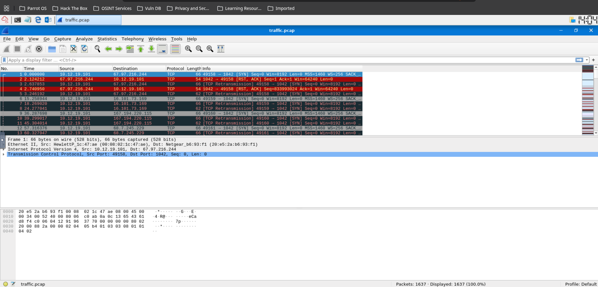
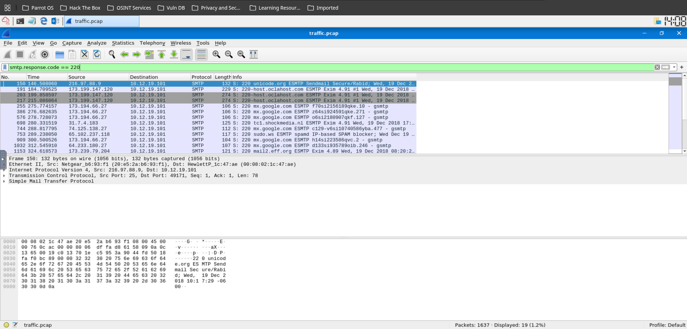
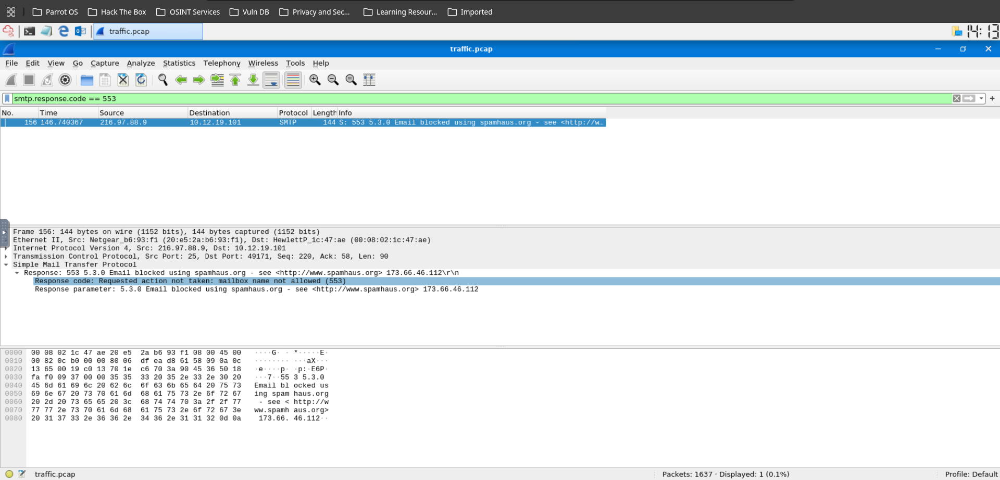
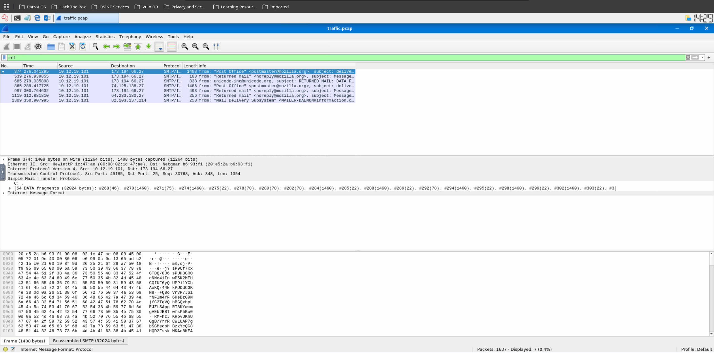
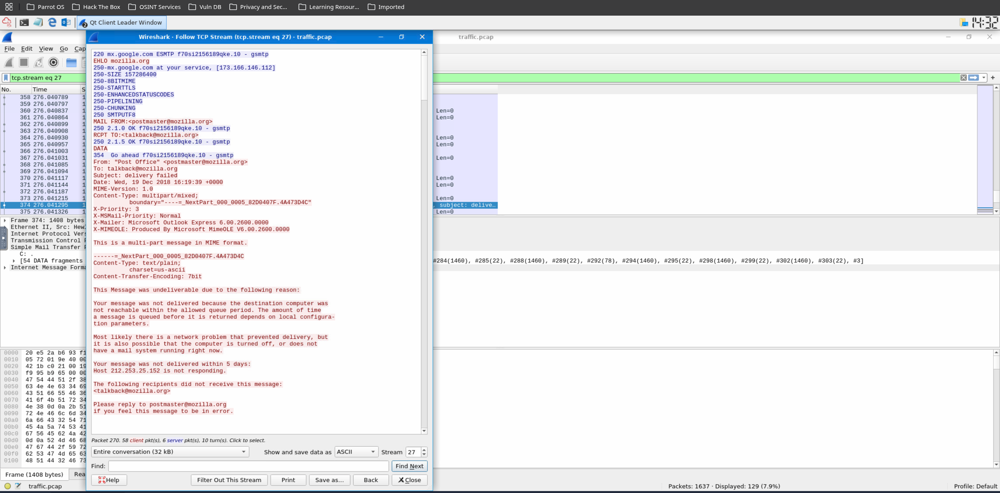
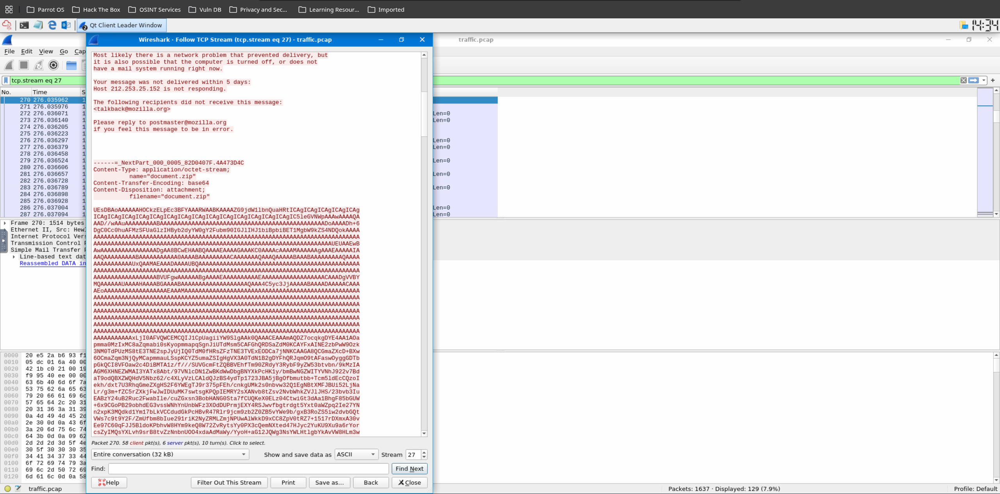

# SMTP Traffic & Email Attachment Analysis (SOC Lab)

## Scenario / Objective
A user reported that an urgent email they were expecting bounced back, and they also received a suspicious email with a `.scr` (screenshot) attachment. As a Level 1 SOC Analyst, my objective
was to analyze network traffic (PCAP) and email message formats (IMF) using Wireshark to determine if the email was malicious, extract the attachment for analysis, and investigate delivery failures.

## Tools Used
*   **Wireshark:** For analyzing network traffic (PCAP) and filtering SMTP protocols.
*   **CyberChef / Base64 Decoder:** For decoding the malicious attachment.

---

## Part 1: SMTP Status Code Analysis (Network Traffic)

**Objective:** Investigate SMTP traffic to understand email delivery failures and identify blocked messages.
   
**Analysis:**
1.  **Traffic Filtering:** I used the Wireshark display filter `smtp.response.code` to isolate server responses.
2.  **Successful Delivery:** I observed `220 Service ready` packets (19 in total), indicating the initial connection to the SMTP server was successful.
    
5.  **Blocked Phishing Attempts:** I found `553` response codes. Message: `Requested action not taken: mailbox name not allowed`. This indicates the server successfully blocked messages attempting to send to invalid or restricted addresses (a common sign of spam/phishing campaigns).
6.  **Spamhaus Blocking:** I also identified a `553` response code where the server specifically returned the message: `Requested action not taken: mailbox name not allowed`. When investigating the full message, the server indicated the email was blocked by **spamhaus.org** due to suspected spam. 
    *   *Analysis:* This shows the organization's email gateway successfully blocked a known malicious sender.
      

---

## Part 2: Inspecting Malicious Email Attachments (.eml)

**Objective:** Analyze a suspicious email to extract and identify the malicious payload.

**Investigation:**
1.  **Locating the Message:** I filtered the traffic using `imf` (Internet Message Format) to find the full email content. I identified a few packet starting from 374.
   
2.  **Email Header Analysis:**
    *   By inspecting packet 374, I found the email was sent using the client **Microsoft Outlook Express 6.00.2600.0000**.
    *   I also noted the sender IP was **`212[.]253[.]25[.]152`**, which was not responding (making the message undeliverable).
   
3.  **Extracting the Payload:**
    * I identified packet '270' as the key message.
    *   The email contained a suspicious attachment named **`document.zip`**.
    *   Looking deeper into the packet details, I found the attachment was encoded in **`base64`**.
    

### Indicators of Compromise (IOCs)
*   **Sender IP:** `212[.]253[.]25[.]152`
*   **Malicious Attachment:** `document.zip` (containing `attachment.scr`)
*   **Encoding Method:** `base64`
*   **Blocking Mechanism:** Spamhaus (Spam Blocking List)

## Conclusion & SOC Verdict
**Verdict: Malicious Activity Identified and Blocked.**

The SMTP traffic analysis revealed that the organization's email gateway successfully blocked multiple delivery attempts from IP `212[.]253[.]25[.]152`. The sender was using a legacy mail client
(Outlook Express) and attempting to deliver a `base64` encoded zip file containing a potentially malicious `.scr` (screenshot/screensaver) executable. 

**SOC Recommendation:** 
*   Add the sender IP (`212[.]253[.]25[.]152`) to the organization's blocklist.
*   Ensure endpoint protection is active to detect any `.scr` files that bypass the email gateway.
